# SUST CSE 23/24 Student Academic Portal
## Work Distribution & Collaboration Roadmap (Afif & Usama — 50/50 Equity)

**Academic Course:** CSE 250 (Software Engineering Lab / Project)  
**Department:** Computer Science & Engineering, Shahjalal University of Science & Technology (SUST)  
**Session:** 2023–2024 (2nd Year, 2nd Semester — 2/2)  

---

### Team Members & Identification

| Team Member | Registration No | Assigned Class Section | Primary Role |
| :--- | :--- | :--- | :--- |
| **Afif Zaman Khan** | `2023331020` (Even Roll) | **Section B** | Frontend Lead & UX Architect |
| **Usama** | `2023331088` (Even Roll) | **Section B** | Backend Lead & Systems Architect |

---

## 1. System Architecture: Two Connected Segments

The project is structured into two decoupled yet tightly integrated segments:

```mermaid
graph LR
    subgraph Afif_Segment["Segment 1: Afif's Domain (Client & UI/UX)"]
        A1["Next.js App Router (TypeScript)"]
        A2["Batch 23 Hero & Fullscreen Landing"]
        A3["Interactive Routine Calendar & Daily Timeline"]
        A4["Official 2/2 Weekly Routine Table (Sec A & B)"]
        A5["Semester Selection & Transcript UI"]
    end

    subgraph Usama_Segment["Segment 2: Usama's Domain (Core Backend Engine)"]
        U1["Go (Golang) REST API Server"]
        U2["PostgreSQL DB & Migration Schemas"]
        U3["JWT Auth, Argon2id & RBAC Middleware"]
        U4["Routine & Student API Services"]
        U5["Token Bucket Rate Limiter & Security Engine"]
    end

    Afif_Segment <-->|"REST API (JSON over HTTP:3000 -> HTTP:8080)"| Usama_Segment
```



---

## 2. Day 1 Completed Work Distribution (50% – 50%)

### **Afif's Part (Frontend & Academic Presentation)**
1. **Fullscreen Batch Photo Landing Page:**
   - 100% full-screen immersive background using `batch_photo.jpg`.
   - Top sky area cleared so that **"CSE ²³"** and **"Shahjalal University of Science & Technology"** 3D lettering are 100% visible and unblocked.
   - Clean frosted glass card with Portal entrance buttons.
   - Clear project developer credits for both Afif and Usama.
2. **Post-Login Semester Selection Screen:**
   - Dedicated semester gatekeeper (1st, 2nd, 3rd completed; 4th Semester active).
   - Prevents premature display of 4th semester data on public landing.
3. **Interactive Daily Schedule Timeline:**
   - Monthly calendar picker with class indicator dots and weekend recognition.
   - Real-time filtering by day of week.
   - Card badges for Course Codes, Room Numbers, Teachers, and Lecture vs Lab sessional.
4. **Section A vs Section B Switcher:**
   - Visual toggle allowing one-click preview of Section A (odd rolls) vs Section B (even rolls).

### **Usama's Part (Backend Engine, Database & Data Architecture)**
1. **Official 2/2 Timetable Matrix & Data Engine:**
   - Transcribed and structured the official SUST CSE 2/2 timetable from Excel into structured data models.
   - Implemented the Section Assignment Algorithm: `Roll % 2 == 0 ? Section B : Section A`.
   - Mapped all 10 official courses, room numbers (`Room 303`, `Gallery 2`, `Room 630`, `Room EEE`, `Room 304`), and faculty initials (`MMH`, `MJI`, `MAT`, `EEE`, `MSC`, `FIF`, `MHM`).
2. **Weekly Timetable Grid Component:**
   - Implemented the official 5-day x 9-period timetable grid table with lunch break shading and multi-period lab spanning.
3. **Go Server & Database Architecture:**
   - Setup Go backend structure (`backend/cmd/server/main.go`).
   - PostgreSQL migration schemas (`migrations/000001_init_schema.up.sql` and `000002_seed_data.up.sql`).
   - Seed data for student profiles (`2023331020` and `2023331088`).
4. **Security & Middleware Infrastructure:**
   - JWT authentication tokens & claims verification (`backend/internal/auth/jwt.go`).
   - Argon2id password hashing and validation (`backend/internal/auth/password.go`).
   - In-memory Token-Bucket Rate Limiter (`backend/internal/middleware/ratelimit.go`).

---

## 3. Git Collaboration Workflow (How Usama & Afif Push Separately)

To ensure **GitHub accurately reflects 50% contributions for both Afif and Usama**:

### Step 1: Usama clones the repo on his machine
```bash
git clone https://github.com/afifzamankhan-lab/proj250.git
cd proj250
```

### Step 2: Usama sets his Git identity
```bash
git config user.name "Usama"
git config user.email "usama@student.sust.edu"  # (or Usama's GitHub account email)
```

### Step 3: Usama creates his feature branch and works
```bash
git checkout -b feature/usama-backend-services
# Usama makes changes or adds new backend routes...
git add .
git commit -m "feat(backend): implement routine and section assignment API endpoints"
git push -u origin feature/usama-backend-services
```

### Step 4: Afif works on his frontend branch
```bash
git checkout -b feature/afif-frontend-portal
# Afif updates frontend components...
git add .
git commit -m "feat(frontend): integrate live routine API and calendar navigation"
git push -u origin feature/afif-frontend-portal
```

### Step 5: Merge via GitHub Pull Request (PR)
- Usama opens a Pull Request on GitHub to merge `feature/usama-backend-services` into `main`.
- Afif reviews and merges the PR.
- Both members get recognized commits on the GitHub Insights & Contribution graph!

---

## 4. 7-Day Complete Development Roadmap (50/50 Equity)

| Day | Afif Zaman Khan (Frontend Lead) | Usama (Backend & Systems Lead) | Connected Outcome |
| :--- | :--- | :--- | :--- |
| **Day 1** (Done) | Fullscreen Batch 23 Hero, Semester Select, Daily Timeline UI | Official Routine Matrix, Section A/B Algorithm, Go JWT Auth & DB Schema | Live frontend prototype + Go Auth backend |
| **Day 2** | Connect Frontend to Go REST API (Axios/Fetch client), Auth Token storage | Implement Go HTTP Handlers for `/api/v1/routine?section=B` and `/api/v1/students` | Frontend dynamically fetches routine from Go API |
| **Day 3** | Course Details Modal: Syllabus view, course objectives, faculty email links | Course Management Service in Go (`/api/v1/courses`) with DB storage | Clicking any course opens official syllabus & details |
| **Day 4** | Attendance UI: Calendar attendance percentage indicators, absent/present log | Attendance Service & Table in PostgreSQL with streak calculator | Students can check attendance per course |
| **Day 5** | Academic Transcript Tab: GPA calculator, grade projection simulator | Grade Calculation Engine in Go, CGPA aggregation service | Accurate transcript calculation verified by backend |
| **Day 6** | Teacher / CR Announcement Noticeboard & Emergency class alert banner | Noticeboard API with WebSocket or Server-Sent Events (SSE) for instant alerts | Instant class cancellation / reschedule notifications |
| **Day 7** | Final UI Polish, Dark/Light Mode toggle, Responsive Mobile optimization | Docker Compose orchestration, PostgreSQL backup script, API test suite | Production-ready full stack portal ready for Sir's defense |

---

## 5. Defense Talking Points (How Usama Explains His Part to Sir)

When Sir asks Usama during project defense:
1. *"What was your specific contribution in this project?"*
   - **Usama's Answer:** *"I designed and built the Core Backend Services and Academic Data Engine. I structured the official 2/2 class routine matrix for both Section A and Section B, implemented the Section auto-assignment algorithm based on student registration numbers, and built the Go backend server with JWT authentication, Argon2 password hashing, and database migrations."*
2. *"How does the Section assignment work in code?"*
   - **Usama's Answer:** *"In SUST CSE, students with even registration last digits belong to Section B (like Afif '20' and me '88'), while odd digits belong to Section A. I implemented the modulo algorithm `regLast2 % 2 == 0 ? Section B : Section A` that automatically filters the timetable and courses."*
3. *"Why did you use Go for the backend?"*
   - **Usama's Answer:** *"Go offers superior concurrency with goroutines, ultra-low memory overhead, fast compilation, and native high-performance HTTP servers, making it ideal for a university portal serving thousands of students concurrently."*
